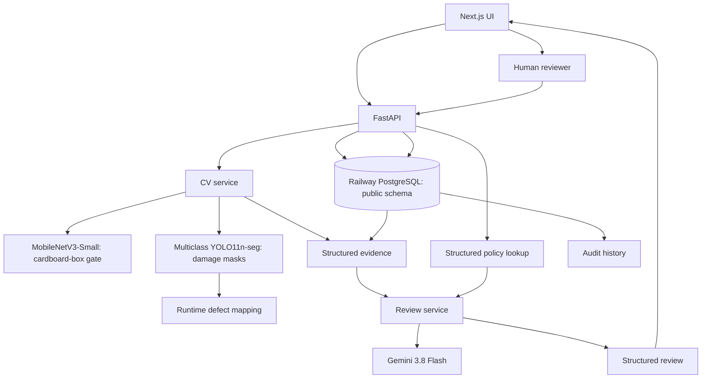

# ReturnReview Architecture

## Evidence boundary

ReturnReview deliberately separates perception from reasoning:

1. **Computer vision observes** visible evidence.
2. **Evidence records** store model version, confidence and regions.
3. **Policy service provides facts** from structured policy records.
4. **LLM interprets** only the evidence + case metadata + policy.
5. **Human reviewer decides** approve/reject/request-more-evidence.

## Runtime architecture

The production API runs the checksum-verified `cv-lightweight-1` release. The
category gate is a MobileNetV3-Small binary classifier; visible-damage
localization is a multiclass YOLO11n-seg model with native classes `tear`,
`squeeze`, and `leakage`. Runtime mapping preserves `tear`, maps `leakage` to
`unknown`, and maps `squeeze` to `crushed_corner` or `dent_or_crush` using the
documented corner-distance heuristic. OpenCLIP is not required in production.

## Safety design

- No final operational decision is delegated to the LLM.
- LLM receives structured evidence, not authority to invent image findings.
- Database writes are deterministic backend actions, not autonomous model tools.
- CV inference refuses to claim success if no trained checkpoint exists.
- Evaluation UI reads persisted metric artifacts and never fabricates numbers.

## Production persistence

Cases, image bytes, CV evidence, overlays, AI reviews, reviewer decisions, and
audit events are stored in the dedicated Railway PostgreSQL service. The API
uses the PostgreSQL `public` schema through Railway private networking; the
database has no public domain. The retained Supabase foundation is historical
and is not the production runtime.

## Model and metric artifacts

`Dockerfile.cv` downloads `best.pt`,
`category_mobilenet_v3_small.pt`, and `release_manifest.json` from the
`cv-lightweight-1` GitHub release. Build-time checksum verification occurs
before the image is accepted. Canonical, reviewed repository metrics live at
`data/evaluation/cv_metrics.json` and `data/evaluation/llm_metrics.json`.
